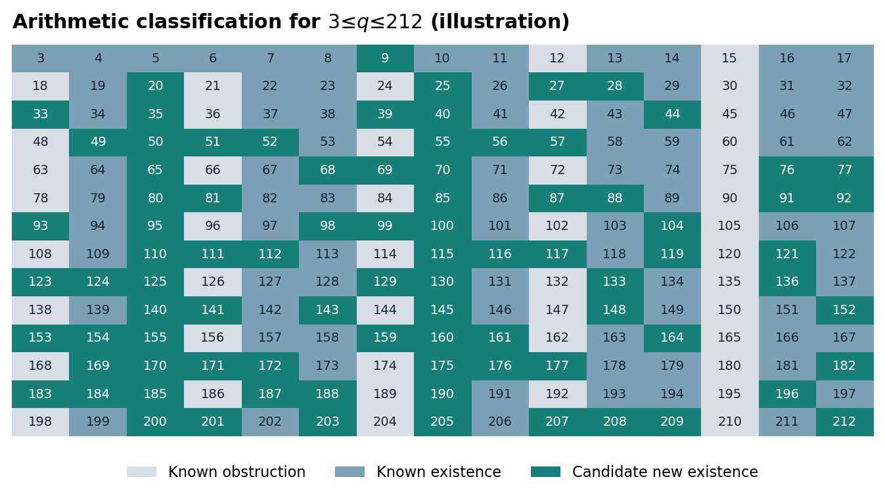

# Uniform Average Mixing on Path Graphs

[](https://github.com/Quantum4242/path-uniform-mixing-classification/actions/workflows/verify.yml)

**An arithmetic classification via positive Fourier densities** · Manuscript `v0.1.0` · Archive candidate `v0.2.0-rc1` · 27 November 2026

[English manuscript (PDF)](paper/paper-en.pdf) | [中文稿 (PDF)](paper/paper-zh.pdf) | [中文说明](README.zh-CN.md) | [Detailed proof](paper/detailed-proof.md) | [Review status](docs/REVIEW.md)

> **Status: candidate proof, released for scrutiny.** This is AI-assisted mathematical research, not an accepted journal paper or a fully formalized theorem. The previous P19 finite Lean certificates do not establish the general classification. The 11 core arithmetic checks passed locally and the maintainer showed a successful GitHub Actions job for the public v0.1.0-based main branch. The badge reflects the public workflow, not this unuploaded archive candidate. The global analytical relation inventory remains subject to external review. Stage-1 Lean source is not yet kernel-compiled.

## Problem and proposed result

Let `A` be the adjacency matrix of the path `P_N`, `N >= 2`, and `q = N+1`. Uniform average mixing asks for a single readout-time probability law satisfying `E |exp(itA)|^(entrywise 2) = J_N/N`. The candidate classification is

**Proposed Classification Theorem**

For every integer q ≥ 3, P<sub>q−1</sub> admits UAM if and only if all three conditions hold:

- 15 ∤ q
- 21 ∤ q
- 6 ∤ q or q = 6

The negative direction, forced coherence reduction, and existence for primes, twice primes and powers of two are **Kang's results**, not new claims. The proposed positive proof for the remaining moduli uses low-degree nonnegative Fourier densities on cyclotomic phase groups and an exact inventory of short signed relations. The same construction gives finite laws on prescribed algebraic-step grids and a conditional uniform Haar floor and known-noise compensation theorem.



The figure illustrates `q=3..212` only. It is a visualization of the proposed rule, not a computational proof of the infinite theorem. The second [figure](figures/finite-margins.png) displays certified lower bounds obtained from rational Fourier sums, not experimental data.

## Research archive and supplements (new in v0.2.0-rc1)

The main manuscript remains unchanged. This archive preserves earlier alternative constructions, data, logs and quantitative results rather than replacing them with the final candidate proof.

- [Complete chronological archive](research-history/README.md) and [contribution ledger / 成果总账](docs/CONTRIBUTIONS.md).
- [Eight topical supplements A–H](supplements/README.md): matching, trees, tensor interpolation, columns, finite certificates, effective readout bounds, robustness and formalization.
- [Post-release finite audit](research-history/21-postrelease-audit/README.md) and [Lean stage 1](lean/stage1/README.md) (uncompiled).
- [Archive release checklist](docs/RELEASE-v0.2.0-rc1.md). P8 is represented by a recovered PDF and link to its separate repository; the full P8 source ZIP was not recovered.

## Read the proof

1. [Main manuscript](paper/paper-en.pdf): theorem, common reduction, local-relation argument, density constructions, grid theorem and conditional noise corollary. The Chinese manuscript is a companion, not a line-by-line translation.
2. [Detailed mathematical proof](paper/detailed-proof.md): complete three-part case analysis, formulas, exact finite margins and proof dependencies. Read this together with the manuscript; it is not merely supporting empirical evidence.
3. [Third audit / quantitative supplement](records/third-audit.md): independent radical/large-prime localization and Haar floor proof. Earlier audit reports are retained in `records/` for provenance.
4. [Review notes](docs/REVIEW.md) and [literature search record](docs/PRIORITY.md): what was checked, what remains open to scrutiny, and the limits of the novelty search.

## Reproduce the arithmetic checks

Python 3 (tested on 3.13.5), SymPy 1.14.0, and a C++17 compiler are required. No Lean or numerical LP solver is required for the classification checks. After installing dependencies, the checks are offline. Do **not** run Python with `-O`, which disables assertions.

```bash
python -m venv .venv
# Linux / macOS:
source .venv/bin/activate
# Windows PowerShell: .\.venv\Scripts\Activate.ps1
python -m pip install -r requirements.txt
python verification/run_checks.py
```

The runner compiles `enumerate_lattice.cpp` locally (default `g++`, or `--cxx clang++`) and runs the checks in dependency order. The complete run on the release environment took about 24 seconds after compilation; other machines will differ. Latest logs go to `records/latest/`. The checked-in [release run](records/release-rerun/summary.log) is the actual completed run, not a predicted result. On Windows use a C++17-compatible MinGW-w64 `g++` or Clang on PATH (Windows was not tested in this release).

```bash
python verification/run_checks.py --quick  # only 2 smoke checks; NOT the full suite
```

| Script(s) | Purpose |
|---|---|
| `verify_short_relations.py`, `verify_three_blocks.py` | Odd cases, symbolic moments and short-relation coefficients |
| `verify_classification.py` | Central arrays and finite exceptional moduli |
| `verify_low_degree.py`, `verify_all.py` | Even symbolic moments and uniform error bounds |
| `verify_small_density.py` | Exact Fourier positivity margins for thirteen even moduli |
| `verify_lattice.py`, `enumerate_lattice.cpp` | Independent exhaustive integer relation lists, 26 groups |
| `verify_q33_density.py` | Independent lattice and square-completion check for q=33 |
| `verify_localization.py`, `verify_uniform_floor.py` | Localization and conditional uniform margin |
| `verify_release_consistency.py` | Congruence partition, small-case bookkeeping and constants |

Figures can be regenerated with `python -m pip install -r requirements-figures.txt` and `python figures/generate.py`. Chinese plots require a CJK font (Noto Sans CJK recommended, or set `CJK_FONT` to an installed font file). Build the manuscripts with `cd paper` and two passes of `xelatex paper-en.tex` and `xelatex paper-zh.tex` (XeLaTeX, AMS packages, ctex and Noto Serif/Sans CJK SC needed). See [build instructions](docs/REPRODUCIBILITY.md). The PDF files are provided for readers without a TeX installation.

Additional optional checks (requires the same Python/SymPy/C++ environment):

```bash
python verification/run_supplement_checks.py
```

This runs the two finite post-release audits and one Lean **source-level** arithmetic cross-check; it does not compile Lean. See [candidate rerun logs](records/v0.2.0-rc1-rerun/). Earlier scripts may retain historical paths and additional discovery dependencies; their original logs are preserved, not all rerun.

## Repository structure

```text
paper/         main papers, editable LaTeX and detailed proof
figures/       reproducible vector/PNG plots and generator
verification/  exact Python/C++ arithmetic checks and rational data
records/       audit trail and actual release verification logs
docs/          scope, review, priority, reproducibility and release notes
lean/          historical P19 finite certificates and uncompiled stage 1
supplements/   eight topical research scope notes and source links
research-history/  original snapshots, exact data, logs and provenance
.github/       core arithmetic CI workflow
SHA256SUMS     integrity manifest for release contents
```

## Lean status

The user's local Lean InfoView showed the P19 `allChecks` theorem elaborated, `Rows checked: 91/91`, and axiom report `[propext]`. These files are included solely to preserve the earlier project history; see [Lean scope](lean/README.md). The real-analytic bridge and the general classification have not been Lean-verified. No claim is made that running the verification suite establishes a kernel proof. See [stage 1](lean/stage1/README.md) for the new uncompiled local-integer and positivity source files.

## Citation, license and contribution

Use [CITATION.bib](CITATION.bib) for the **versioned research draft**, and cite the underlying literature for the results it established. No personal author or DOI has been assigned to this draft. Authorship and any public-release metadata must be confirmed by the repository maintainer. AI tools assisted with derivation, coding, drafting and internal review. See [license proposal](docs/LICENSING.md); verify rights and confirm the proposed MIT code / CC BY 4.0 documentation licenses before any further redistribution. External papers are linked, not redistributed.

Corrections and counterexamples are welcome. For mathematical issues, identify the theorem/lemma or DP part and provide the offending relation or proof step; for computational issues, include the environment and exact reproduction command. Please distinguish a failed sufficient bound from a proof of nonexistence. A GitHub upload is not peer review.
