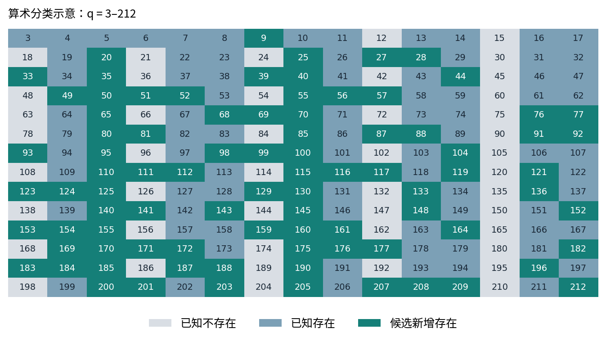

# 路径图均匀平均混合的算术分类

研究预印本候选版 v0.1.0（2026-11-27）。[英文主稿](paper/paper-en.pdf) · [中文配套稿](paper/paper-zh.pdf) · [完整详细证明](paper/detailed-proof.md) · [复现日志](records/release-rerun/summary.log)

研究对象是路径图 `P_N` 上的连续时间邻接量子行走。设 `q=N+1>=3`，目标是寻找同一随机读出时间分布，使所有初态的平均位置概率均为 `1/N`。候选分类：当且仅当 q 不被 15 或 21 整除，并且 q 不被 6 整除或 q=6 时，均匀平均混合存在。

否定方向、强制相干矩与素数/两倍素数/2 的幂次的正例属于 Kang 已有结果。本项目拟贡献剩余充分性的统一 Fourier 密度证明；附加结论为代数时间网格、统一 Haar 成分及已知时间噪声补偿。一般短关系归约和局部分类仍须独立专业审查。**本包不是已经同行评议的论文，也不是完整 Lean 4 证明。**



## 使用方法

1. 先阅读两份 PDF，详细数学证明以英文主稿与 `paper/detailed-proof.md` 合读为准；中文稿概述完整证明链，并非英文附录逐字翻译。
2. 安装 Python 及支持 C++17 的 `g++`（Windows 可用 MinGW-w64），在目录中执行：

```powershell
python -m venv .venv
.\.venv\Scripts\Activate.ps1
python -m pip install -r requirements.txt
python verification/run_checks.py
```

Linux/macOS 虚拟环境使用 `source .venv/bin/activate`。当前包中十一项检查已在 Linux/Python 3.13.5/SymPy 1.14.0 实际跑通。Windows 复现步骤已准备但未实际测试。`--quick` 只执行两项轻量检查。不要使用 `python -O`。

3. `records/release-rerun/summary.log` 是实际运行摘要；`docs/REVIEW.md` 记录仍需外部审查的环节；`docs/PRIORITY.md` 保存检索范围和文献；`lean/` 保存此前 P19 的有限证书，与一般定理严格分开。
4. 重新作图：安装 `requirements-figures.txt`，运行 `python figures/generate.py`。重新排版需 XeLaTeX 和 CJK 字体；详见 `docs/REPRODUCIBILITY.md`。

## 公开发布前

本包不含个人署名、未建立新的 DOI、未上传 GitHub。建议将仓库名称设为 `path-uniform-mixing-classification`，版本 `v0.1.0` 并标记 pre-release / research draft。务必阅读 [发布说明](docs/RELEASE.md) 与 [许可方案](docs/LICENSING.md)，确认许可证和署名政策。允许同行报告错误、补充在先研究及提出严格反例。公开仓库并不等于正式期刊发表或完整形式化验证。
